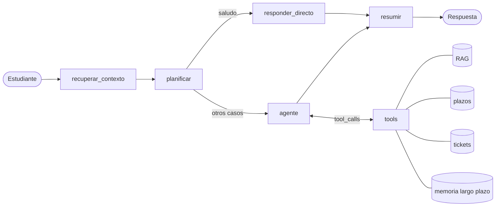

# Agente de Soporte Académico

Agente funcional construido con **LangGraph** para la Evaluación Parcial 2 de *Ingeniería de Soluciones con IA* (ISY0101). Resuelve consultas de estudiantes (titulación, becas, notas, certificados, prácticas), calcula plazos en días hábiles y deriva casos a un ejecutivo humano mediante tickets.

> Los documentos de `data/docs` y los plazos de `data/plazos.json` son **de ejemplo (ficticios)**. Para un caso real se reemplazan por los de la institución sin tocar el código.

**Integrantes:** _(completar nombres)_

## Qué hace el agente
- **Consulta** documentos académicos con RAG y cita la fuente.
- **Razona** sobre plazos: calcula fecha límite en días hábiles y clasifica el estado (VIGENTE / URGENTE / VENCIDO).
- **Escribe**: crea tickets en SQLite con prioridad (alta / media / baja) y guarda datos del estudiante en memoria de largo plazo.
- **Planifica y se adapta**: un planificador genera un plan priorizado y enruta: los saludos van por una ruta corta sin tools; si no hay información reformula la búsqueda y luego deriva; si un plazo está vencido escala con prioridad alta.
- **Recuerda**: historial por conversación (corto plazo), resumen automático del contexto y memoria semántica por estudiante entre conversaciones (largo plazo).

## Arquitectura
Diagrama completo y justificación de cada componente en [`docs/arquitectura.md`](docs/arquitectura.md).



| Componente | Archivo | Rol |
|---|---|---|
| Orquestación | `agente/grafo.py` | Grafo LangGraph: contexto, plan, ReAct, resumen |
| Tools | `agente/tools.py` | `buscar_reglamento`, `calcular_plazo`, `crear_ticket`, `consultar_tickets`, `guardar_memoria`, `recordar` |
| RAG | `agente/rag.py` | Chunking por secciones, índice vectorial, umbral de relevancia |
| Embeddings | `agente/embeddings.py` | OpenRouter (semántico) con respaldo local |
| Memoria largo plazo | `agente/memoria.py` | SQLite + similitud coseno, por estudiante |
| Memoria corto plazo | `agente/grafo.py` | Checkpointer SQLite por `thread_id` |
| LLM | `agente/llm.py` | OpenRouter (API compatible con OpenAI) |

## Requisitos
- Python 3.10 o superior
- Una API key de OpenRouter (sólo para `main.py` y `demo.py`; los tests no la necesitan)

## Instalación
```bash
git clone <URL-DEL-REPO>
cd agente-soporte-academico
python -m venv .venv
source .venv/bin/activate        # Windows: .venv\Scripts\activate
pip install -r requirements.txt
cp .env.example .env             # Windows: copy .env.example .env
# editar .env y pegar la API key en OPENROUTER_API_KEY
```

## Uso
```bash
python -m pytest -v        # pruebas automáticas (sin red ni costo)
python demo.py             # 6 escenarios guionados con el modelo real
python main.py             # chat interactivo
python main.py --user ana --thread t1   # estudiante y conversación específicos
python main.py --reindex   # reconstruir el índice RAG
```
Comandos dentro del chat: `/nuevo` (nueva conversación, conserva la memoria de largo plazo), `/memoria`, `/tickets`, `/salir`.

## Configuración (`.env`)
| Variable | Por defecto | Descripción |
|---|---|---|
| `OPENROUTER_API_KEY` | — | API key (no subir a git) |
| `AGENT_MODEL` | `openai/gpt-6-luna` | Modelo en OpenRouter |
| `REASONING_EFFORT` | `low` | Esfuerzo de razonamiento (menor costo) |
| `EMBEDDING_BACKEND` | `auto` | `auto`, `openrouter` o `local` |
| `EMBEDDING_MODEL` | `openai/text-embedding-3-small` | Modelo de embeddings |
| `MAX_MESSAGES_BEFORE_SUMMARY` | `12` | Umbral para resumir el historial |
| `KEEP_LAST_MESSAGES` | `6` | Mensajes recientes que se conservan |

Con `EMBEDDING_BACKEND=auto` se usan embeddings semánticos por OpenRouter y, si no están disponibles, un respaldo local léxico (con aviso en consola).

## Estructura del repositorio
```
agente/            código del agente (grafo, tools, rag, memoria, embeddings, llm, runner)
data/docs/         documentos académicos de ejemplo (base del RAG)
data/plazos.json   plazos en días hábiles por trámite
tests/             pruebas automáticas (LLM simulado)
docs/              arquitectura.md, pruebas.md
main.py            chat interactivo
demo.py            escenarios para la presentación
```

## Pruebas
Ver [`docs/pruebas.md`](docs/pruebas.md): 23 pruebas automáticas que verifican ruteo, elección de tools, escalamiento, memoria de corto y largo plazo y resumen de contexto, más los 6 escenarios de `demo.py`.

## Cómo extenderlo
- **Nueva tool:** función con `@tool` y docstring claro en `agente/tools.py` y agregarla a `TOOLS`.
- **Nuevos documentos:** agregar `.md` con secciones `##` a `data/docs/` y ejecutar `python main.py --reindex`.
- **Nuevo trámite con plazo:** agregarlo a `data/plazos.json`.
- **Tools en un servidor aparte:** exponerlas como servidor MCP o API REST y reemplazar las funciones por clientes; el grafo no cambia.

## Limitaciones
Datos de ejemplo; el respaldo local de embeddings es léxico; no hay autenticación de usuarios; el planificador depende de que el modelo devuelva JSON (si falla se usa un plan por defecto).

## Uso de IA
_(Declarar aquí y en el informe qué herramientas de IA se usaron y cómo, según la pauta.)_

## Referencias
- LangChain AI. (s. f.). *LangGraph documentation*. https://langchain-ai.github.io/langgraph/
- OpenRouter. (s. f.). *API documentation*. https://openrouter.ai/docs
- Yao, S., Zhao, J., Yu, D., Du, N., Shafran, I., Narasimhan, K., & Cao, Y. (2023). ReAct: Synergizing reasoning and acting in language models. *ICLR 2023*. https://arxiv.org/abs/2210.03629
- Lewis, P., Perez, E., Piktus, A., et al. (2020). Retrieval-augmented generation for knowledge-intensive NLP tasks. *NeurIPS 2020*. https://arxiv.org/abs/2005.11401
