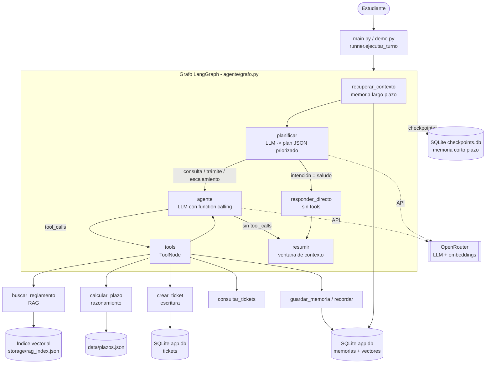

# Arquitectura y decisiones de diseño

## Diagrama de orquestación

## Flujo de un turno
1. **recuperar_contexto**: busca por similitud semántica los recuerdos del estudiante relacionados con su mensaje.
2. **planificar**: el LLM clasifica la intención y la urgencia y genera subtareas ordenadas por prioridad (JSON). Si el JSON falla, se usa un plan por defecto (robustez).
3. **Ruteo adaptativo**: un saludo va por la ruta corta (sin tools, menor costo y latencia); el resto entra al bucle ReAct.
4. **agente ⇄ tools**: el LLM decide qué tool llamar, observa el resultado y decide el siguiente paso hasta responder.
5. **resumir**: si el historial supera `MAX_MESSAGES_BEFORE_SUMMARY`, resume lo antiguo y conserva los últimos mensajes.

## Memoria
| Tipo | Mecanismo | Dónde | Alcance |
|---|---|---|---|
| Corto plazo | Checkpointer `SqliteSaver` de LangGraph | `storage/checkpoints.db` | Por `thread_id` (una conversación) |
| Contexto largo | Resumen incremental + últimos N mensajes | Estado del grafo (checkpoint) | Por `thread_id` |
| Largo plazo | Texto + embedding en SQLite, recuperación por coseno | `storage/app.db` (tabla `memorias`) | Por `user_id`, entre conversaciones |

## Herramientas
| Tool | Tipo | Qué hace | Señal de decisión que entrega al agente |
|---|---|---|---|
| `buscar_reglamento` | Consulta | RAG sobre `data/docs` con fuente y score | `SIN_RESULTADOS` si nada supera el umbral → reformular o derivar |
| `calcular_plazo` | Razonamiento | Días hábiles + fecha límite | `VIGENTE` / `URGENTE` / `VENCIDO` → decide ticket de prioridad alta |
| `crear_ticket` | Escritura | Inserta ticket en SQLite | Id y SLA según prioridad; valida entradas |
| `consultar_tickets` | Consulta | Lista tickets del estudiante | — |
| `guardar_memoria` / `recordar` | Escritura / consulta | Memoria de largo plazo | Evita duplicados (coseno > 0,95) |

## Justificación de componentes (IE9)
| Decisión | Alternativas | Por qué |
|---|---|---|
| **LangGraph** | AutoGen, Haystack, LangChain AgentExecutor | Grafo explícito con estado, ruteo condicional y checkpointer nativo; cada decisión del agente queda visible y testeable. Escala agregando nodos. |
| **OpenRouter** (API OpenAI-compatible) | API directa de un proveedor | Es la key que entrega el docente; cambiar de modelo es sólo una variable de entorno. |
| **SQLite** para checkpoints, memoria y tickets | Postgres, Redis | Cero infraestructura, persistente y reproducible para el evaluador; migrable a Postgres cambiando el checkpointer. |
| **Embeddings por API + respaldo local** | Sentence-Transformers local, Chroma/FAISS | Evita instalar modelos pesados; el respaldo local garantiza que todo corra sin red. Con ~20 fragmentos, un producto punto en NumPy es suficiente; con miles se cambiaría por FAISS/Chroma. |
| **Planificador separado** | Dejar todo al bucle ReAct | Permite priorizar subtareas, enrutar casos triviales sin gastar tools y medir la decisión por separado. |
| **Resumen + ventana deslizante** | Enviar todo el historial | Controla el costo y el tamaño de contexto en conversaciones largas. |

## Preguntas esperables en la defensa
- **¿Cómo sabe qué tool elegir?** El LLM recibe el nombre, el docstring y el esquema de argumentos de cada tool (function calling) y devuelve un `tool_call`. Además el prompt fija reglas (ej. "usar `buscar_reglamento` antes de afirmar normas") y el plan prioriza subtareas.
- **¿Cómo se agrega una tool nueva?** Se escribe una función con `@tool` y docstring claro en `agente/tools.py` y se agrega a la lista `TOOLS`. El grafo la toma sin más cambios.
- **¿Cómo maneja la ventana de contexto?** Nodo `resumir`: cuando hay más de 12 mensajes resume los antiguos en un texto corto (guardado en el estado) y elimina esos mensajes, dejando los últimos; el corte siempre cae al inicio de un turno para no separar una llamada a tool de su resultado.
- **¿Dónde guarda el historial?** En `storage/checkpoints.db` (SQLite) mediante el checkpointer de LangGraph, indexado por `thread_id`. Los recuerdos duraderos van aparte, en la tabla `memorias`, indexados por `user_id`.
- **¿Y si las tools estuvieran en otro servidor?** Se expondrían como servidor **MCP** (o API REST con FastAPI) y el agente pasaría a ser cliente: se reemplazan las funciones locales por clientes (por ejemplo `langchain-mcp-adapters`) y el resto del grafo no cambia. Ganancia: aislamiento, escalado y reutilización por otros agentes. Costo: latencia, autenticación y manejo de fallos de red.
- **Limitaciones reconocidas:** el respaldo local de embeddings es léxico (no semántico); los documentos y plazos son de ejemplo; no hay autenticación de usuarios; el planificador depende de que el LLM devuelva JSON válido (hay plan por defecto si falla).
